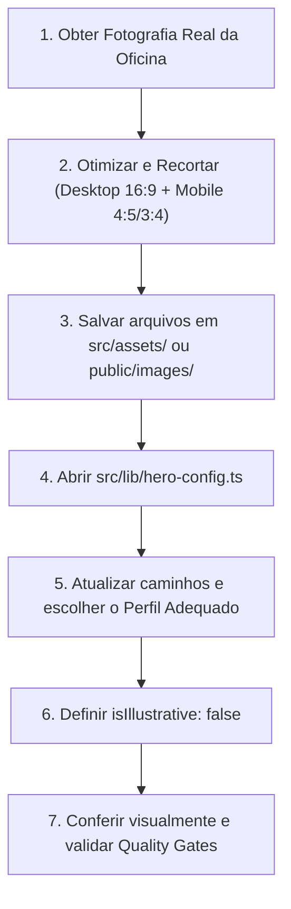

# Guia Operacional — Substituição e Calibração da Foto do Hero (BRS Reparações Automotivas)

> **Documento Normativo — SPEC-068**  
> Destinado a engenheiros de software, designers, proprietários da oficina e agentes de inteligência artificial (LLMs).

---

## 1. Visão Geral do Desacoplamento

Toda a animação cinematográfica do Hero (revelação gradual da interface, zoom lento da imagem e reflexo de luz na lataria) foi **completamente desacoplada dos arquivos de imagem**.

Toda a dependência da foto reside em um único arquivo de configuração tipado:
👉 [`src/lib/hero-config.ts`](file:///home/elessandro/%C3%81rea%20de%20Trabalho/Dev/EPMDEVTECH_Clientes/BRS/src/lib/hero-config.ts)

Para substituir a foto ilustrativa atual por uma fotografia real da oficina, **não é necessário alterar nenhuma linha de código CSS, temporizador ou JSX de animação**.

---

## 2. Passo a Passo para Trocar a Imagem



### Passo 1: Salvar os arquivos de imagem
Coloque a nova imagem em `src/assets/` (ex: `src/assets/hero-oficina-real.jpg`) ou na pasta pública `public/images/`. Recomendamos gerar também versões compactas `.webp` ou `.avif`.

### Passo 2: Atualizar a configuração em `src/lib/hero-config.ts`
Importe o arquivo e atualize o objeto `defaultHeroConfig`:

```typescript
import novaFotoHero from "@/assets/hero-oficina-real.jpg";

export const defaultHeroConfig: HeroConfig = {
  // 1. Escolha o perfil: 'veiculo-inteiro' | 'detalhe-lataria' | 'oficina-equipe'
  profile: "oficina-equipe",

  // 2. Foto REAL: mude para false para remover o selo "Fotografia ilustrativa"
  isIllustrative: false,

  image: {
    desktop: {
      src: novaFotoHero,
      width: 2560,
      height: 1440,
      webpSrc: "/images/hero-oficina-real.webp", // opcional
    },
    mobile: {
      src: novaFotoHero,
      width: 1200,
      height: 1500,
      webpSrc: "/images/hero-oficina-real-mobile.webp", // opcional
    },
    alt: "Oficina técnica e estufa de pintura da BRS Reparações em Toledo-PR",
    decorative: false,
  },
};
```

---

## 3. Especificações Técnicas das Fotografias

| Parâmetro | Versão Desktop | Versão Mobile |
| :--- | :--- | :--- |
| **Proporção (Aspect Ratio)** | `16:9` widescreen | `4:5` ou `3:4` vertical |
| **Dimensão Mínima** | `2560 × 1440 px` | `1200 × 1500 px` |
| **Margem para Zoom (+10%)** | Obrigatória: o zoom escala a imagem até `1.10`. Uma foto de 2560px garante nitidez absoluta sem pixelização. | O zoom mobile escala até `1.05`. |
| **Posicionamento do Assunto** | Concentrado à **direita** (a partir de 50-55% da largura), pois a tipografia do Hero fica à esquerda. | Concentrado no **terço central/superior**. |
| **Peso Alvo (AVIF/WebP)** | `200 a 300 KB` | `120 a 180 KB` |

> [!CAUTION]
> **Privacidade e Conformidade Legal:**
> - **Placas de Veículos**: Nenhuma placa de veículo deve estar legível na fotografia. Borre ou remova placas antes de publicar.
> - **Rostos de Pessoas**: Qualquer técnico ou cliente visível deve ter termo formal de autorização de imagem para veiculação comercial.
> - **Logotipos de Montadoras**: Evite destacar emblemas e logos de montadoras para preservar a independência técnica da oficina.

---

## 4. Perfis Arquiteturais Disponíveis

| Perfil | Quando Utilizar | Comportamento do Zoom | Reflexo de Luz (Flare) |
| :--- | :--- | :--- | :--- |
| `veiculo-inteiro` | Foto ampla de um carro completo ou reparo estrutural concluído. | Ancorado no veículo à direita (`75% 50%`). | **Ativo** na região do capô/paralama (ângulo 115°, opacidade 0.32). |
| `detalhe-lataria` | Close-up macro em acabamento de verniz, polimento ou painel. | Ancorado no detalhe da pintura (`60% 50%`). | **Ativo**, mais largo (70%) e opacidade moderada (0.25). |
| `oficina-equipe` | Foto interna da oficina, estufa de pintura, ferramentas ou equipe técnica. | Suave e centralizado (`50% 50%`). | **DESATIVADO** (`enabled: false`) para não produzir brilho artificial sobre pessoas ou instalações. |

---

## 5. Explicação Detalhada dos Campos de Configuração

- `profile`: Nome do perfil predefinido (`veiculo-inteiro` | `detalhe-lataria` | `oficina-equipe`).
- `isIllustrative`: Controla estritamente a exibição do badge `"Fotografia ilustrativa"` na barra inferior de viewport.
  - `true`: Renderiza o selo de transparência.
  - `false`: Oculta completamente o selo quando a imagem for real.
- `image`:
  - `desktop` / `mobile`: Objeto contendo `src`, `width`, `height`, e caminhos opcionais `avifSrc` e `webpSrc`.
  - `alt`: Descrição acessível para leitores de tela.
  - `decorative`: Se `true`, insere `alt=""` e `aria-hidden="true"`.
- `composition`:
  - `objectPosition`: Ponto de ancoragem da imagem no recorte (`object-fit: cover`).
  - `transformOrigin`: Ponto focal em torno do qual a imagem é ampliada pelo zoom cinematográfico.
- `overlay`:
  - `textSide`: Lado da coluna de texto (`left` por padrão).
  - `fromGradient`, `viaGradient`, `toGradient`: Níveis de escurecimento para contraste com o texto.
- `flare`:
  - `enabled`: Liga ou desliga o reflexo.
  - `top`, `left`, `width`, `height`: Posição relativa em `%` sobre a imagem onde a luz passa.
  - `angle`: Inclinação em graus da faixa diagonal de luz (ex: `115deg`).
  - `maxOpacity`: Brilho máximo atingido no pico da passagem (0.0 a 1.0).

---

## 6. Modo de Depuração e Calibração Visual (Apenas DEV)

Para visualizar com exatidão onde o reflexo de luz está passando e ajustar as porcentagens:

1. No componente da página ou rota, passe `debugMode={true}` para o `<Hero debugMode={true} />`.
2. O contêiner exibirá um contorno tracejado verde em volta do Hero e uma caixa âmbar destacando a **Zona de Reflexo (`Flare Zone`)**.
3. O código do modo debug utiliza `import.meta.env.DEV` e é **100% eliminado pelo compilador em produção (zero bytes adicionais no bundle final)**.

---

## 7. Checklist de Verificação Visual Antes de Publicar

- [ ] A foto real possui resolução de pelo menos 2560px de largura?
- [ ] O texto branco e o botão CTA permanecem legíveis com contraste WCAG AA (mínimo 4.5:1)?
- [ ] O assunto principal da imagem permanece no enquadramento durante os 24s do zoom lento?
- [ ] No mobile, a imagem não corta pessoas ou o veículo ao meio?
- [ ] O reflexo de luz está desligado se a foto for de equipe/oficina?
- [ ] O flag `isIllustrative: false` foi ativado para foto real?
- [ ] O comando `bun run test` e `bun run build` executam com 100% de sucesso?
- [ ] As tags `og:image` e `twitter:image` em `src/lib/seo.ts` foram atualizadas com a nova imagem?

---

## 8. Pipeline Responsivo e Geração das Variantes (SPEC-069)

O Hero serve **AVIF** (primário), **WebP** (secundário) e o **JPG importado** (fallback universal). As variantes modernas ficam versionadas em `public/hero/` com URL estável, para que o `preload` de LCP aponte para o mesmo candidato que o `<picture>` escolhe (sem download duplicado).

### 8.1 Como gerar as variantes (sem novas dependências)

Nenhuma biblioteca de build é utilizada. A geração é feita por CLI com o **ImageMagick** (`convert`), já disponível no ambiente:

```bash
SRC=src/assets/brs-hero.jpg

convert "$SRC" -resize 1920x1088 -quality 55 public/hero/hero-1920.avif
convert "$SRC" -resize 1920x1088 -quality 80 -define webp:method=6 public/hero/hero-1920.webp
convert "$SRC" -resize 1280x725  -quality 55 public/hero/hero-1280.avif
convert "$SRC" -resize 1280x725  -quality 80 -define webp:method=6 public/hero/hero-1280.webp
convert "$SRC" -resize 960x544   -quality 55 public/hero/hero-960.avif
convert "$SRC" -resize 960x544   -quality 80 -define webp:method=6 public/hero/hero-960.webp
```

> As larguras `960`, `1280` e `1920` compõem o `srcset` responsivo. Mantenha 3 larguras por formato.

### 8.2 Pesos de referência medidos (asset ilustrativo 1920×1088)

| Formato | 1920w | 1280w | 960w |
| :--- | :--- | :--- | :--- |
| AVIF (quality 55) | ~59 KB | ~34 KB | ~23 KB |
| WebP (quality 80) | ~79 KB | ~44 KB | ~28 KB |
| JPG (fallback, original) | ~186 KB | — | — |

### 8.3 Regras a respeitar ao trocar a foto

- Atualize `width`/`height` em `defaultHeroConfig.image` para a **resolução real** do novo arquivo (evita CLS e reserva de proporção incorreta).
- Mantenha `sizes: "100vw"` enquanto a foto cobrir toda a largura do Hero.
- A fonte deve ter folga de resolução ≥ 10 % sobre o tamanho exibido (o zoom chega a `1.10`). Prefira gerar a variante desktop a partir de uma foto com **pelo menos 2560 px** de largura.
- Rode `bun run test` (inclui `hero-config.test.tsx`) e o Playwright `hero-visual-baseline.spec.ts` para validar que o perfil `veiculo-inteiro` não regrediu.


## 9. Evidência Visual de Linha do Tempo

O teste `e2e/hero-visual-baseline.spec.ts` grava capturas em `0 s`, `5 s`, `6 s` e `10 s` (desktop, mobile e reduced-motion) em `test-results/` como evidência manual, e compara a composição estabilizada contra o baseline versionado em `e2e/hero-visual-baseline.spec.ts-snapshots/`.
