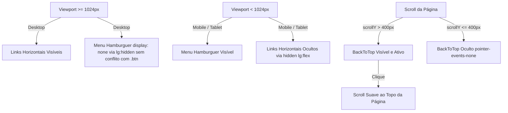

# SPEC-024 — Correção do Menu Hamburguer no Desktop, Remoção do Ícone Flutuante e Botão Voltar ao Topo

## Metadados

| Campo         | Valor                                                                                     |
| ------------- | ----------------------------------------------------------------------------------------- |
| Identificador | `SPEC-024`                                                                                |
| Título        | Correção do Menu Hamburguer no Desktop, Remoção do Ícone Flutuante e Botão Voltar ao Topo |
| Autor         | Staff Frontend Engineer & UX/UI Designer (EPMDEVTECH)                                     |
| Status        | Aprovado                                                                                  |
| Data          | 2026-10-12                                                                                |
| Versão        | 1.0.0                                                                                     |

---

## 1. Contexto e Problema

1. **Exibição Indevida do Menu Hamburguer no Desktop**:
   - No desktop (larguras $\ge 1024\text{px}$), o botão de menu hamburguer estava visível simultaneamente com a barra de navegação horizontal primária.
   - **Causa Raiz**: O botão utilizava o componente `<Button size="icon" className="lg:hidden ...">`. A classe canônica `.btn` estava declarada de forma não-camada (`unlayered`) em `src/styles.css` com `display: inline-flex`. Na cascata do CSS, estilos não-camadas possuem precedência absoluta sobre regras contidas em `@layer` do Tailwind CSS v4 (como `@media (width >= 64rem) { .lg\:hidden { display: none; } }`). Como consequência, a regra `display: inline-flex` sobrepujava `display: none` em viewports desktop.
2. **Ícone Flutuante no Canto Inferior Direito**:
   - Um botão fixo com ícone de telefone (`fixed bottom-5 right-5 z-20 md:hidden`) permanecia no canto inferior direito, gerando poluição visual e confusão comercial com botões de WhatsApp não confirmados.
3. **Ausência de Botão "Voltar ao Topo"**:
   - Páginas com rolagem vertical extensa (como homepage, serviços e galeria) necessitavam de um atalho tátil elegante e acessível para retorno suave ao topo da página.

---

## 2. Requisitos e Critérios de Aceitação

### AC-024-01: Ocultação Estrita do Menu Hamburguer no Desktop

- O botão do menu hamburguer deve permanecer 100% oculto (`display: none`) em resoluções desktop ($\ge 1024\text{px}$).
- O menu hamburguer deve continuar visível e totalmente funcional em telas móveis e tablets ($< 1024\text{px}$).
- O componente `Header` não deve aplicar classes de botão que conflitem na cascata do CSS sobre o utilitário `lg:hidden`.

### AC-024-02: Remoção do Botão Flutuante de Telefone

- O botão flutuante fixo no canto inferior direito (`src/components/brs/site-layout.tsx`) com ícone de telefone deve ser completamente removido de todas as rotas.

### AC-024-03: Botão Premium "Voltar ao Topo" (`BackToTop`)

- Implementar um componente reutilizável `BackToTop` em `src/components/ui/back-to-top.tsx` e integrá-lo globalmente no `SiteLayout`.
- **Comportamento de Scroll**:
  - Permanecer invisível quando a rolagem vertical for menor que $400\text{px}$ (`window.scrollY <= 400`).
  - Transicionar suavemente para visível (`opacity-100 translate-y-0`) quando a rolagem ultrapassar $400\text{px}$.
- **Interação**:
  - Ao ser acionado (clique ou Enter/Espaço), executar rolagem suave (`window.scrollTo({ top: 0, behavior: 'smooth' })`).
  - Respeitar preferência do sistema por redução de movimento (`prefers-reduced-motion` executando scroll instantâneo).
- **Estética & Design Tokens**:
  - Fundo em glassmorphism escuro (`bg-neutral-900/80 backdrop-blur-md hover:bg-neutral-800`), borda sutil com acento dourado champanhe no hover (`border border-white/10 hover:border-primary/50`), ícone `ArrowUp` ou `ChevronUp` centrado.
  - Alinhamento fixo no canto inferior direito (`fixed bottom-6 right-6 z-40`).
  - Touch target acessível com dimensões normativas $44 \times 44\text{px}$ e raio normativo $\text{var}(--\text{radius-sm})$ ($4\text{px}$).
  - Acessibilidade: `aria-label="Voltar ao topo da página"`, anel de foco dourado com alto contraste (`focus-visible:outline-2 focus-visible:outline-primary`).

---

## 3. Arquitetura da Solução

---

## 4. Quality Gates

1. `bun run test`: 100% dos testes unitários e de integração Vitest passando.
2. `bunx playwright test`: 100% dos testes E2E Playwright passando, validando invisibilidade do hamburguer no desktop e visibilidade do BackToTop após scroll.
3. `bun run lint`: 0 erros no ESLint.
4. `bun run build`: Compilação limpa do Vite e Nitro SSR.
