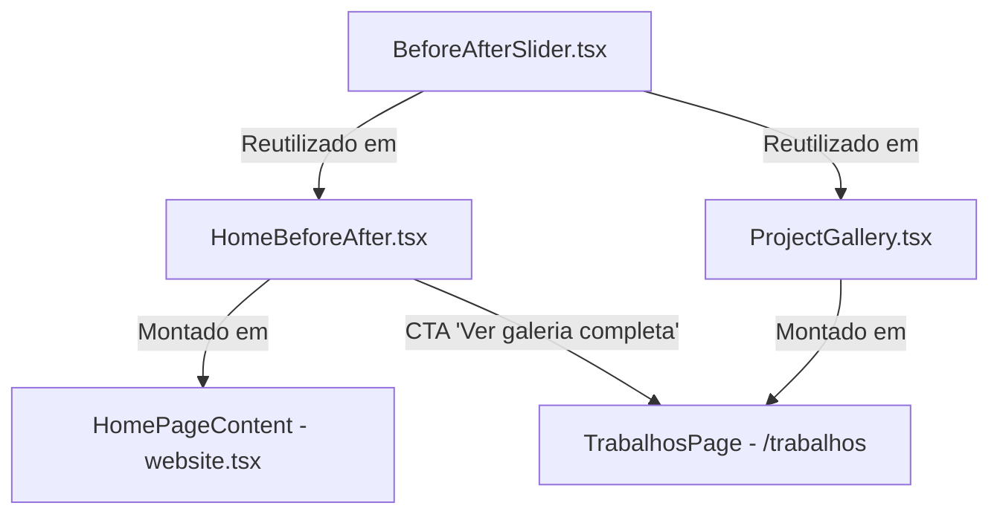

# SPEC-025 — Comparador Antes e Depois: Home, Galeria e Componente Reutilizável

## Metadados

| Campo         | Valor                                                              |
| ------------- | ------------------------------------------------------------------ |
| Identificador | `SPEC-025`                                                         |
| Título        | Comparador Antes e Depois: Home, Galeria e Componente Reutilizável |
| Autor         | Staff Frontend Engineer & UX/UI Designer (EPMDEVTECH)              |
| Status        | Aprovado                                                           |
| Data          | 2026-10-12                                                         |
| Versão        | 1.0.0                                                              |

---

## 1. Contexto e Objetivos

Demonstrar visualmente a excelência técnica dos serviços de funilaria automotiva, pintura em estufa e martelinho de ouro da **BRS Reparações Automotivas** através de um comparador interativo de imagens **Antes e Depois**.

O componente deve ser reutilizável, rigorosamente acessível, performático em SSR e responsivo, integrado:

1. **Na Página Inicial (Home)**: logo abaixo dos botões de ação do Hero e sua faixa de atributos, servindo de transição natural e oferecendo um CTA direto para a galeria completa.
2. **Na Página de Trabalhos (`/trabalhos`)**: através do módulo `ProjectGallery`, permitindo inspeção em grid e modal Lightbox em alta definição.

---

## 2. Requisitos e Critérios de Aceitação

### AC-025-01: Componente Reutilizável `BeforeAfterSlider`

- **Controle Preciso**: Divisor controlável por ponteiro (mouse drag, touch pan com `touch-pan-y` sem interromper o scroll vertical da página) e teclado.
- **Teclado & Semântica ARIA**:
  - `role="slider"`, `tabIndex={0}`, `aria-valuemin={0}`, `aria-valuemax={100}`, `aria-valuenow={Math.round(position)}`.
  - Setas (`ArrowLeft`/`ArrowRight`/`ArrowUp`/`ArrowDown`) ajustando $\pm 5\%$.
  - `PageDown` / `PageUp` ajustando $\pm 10\%$.
  - `Home` ($0\%$) e `End` ($100\%$).
- **Performance de Renderização**: Recorte acelerado por hardware via CSS `clipPath: inset(...)` na camada superior ("Antes"), enquanto a camada de referência ("Depois") permanece na base enquadrada.
- **Feedback & Affordance**: Indicação visual secundária e discreta ("Arraste o divisor para comparar"), badges contextuais com fade proporcional à posição da divisão e indicador de foco acessível.
- **Suporte a Imagens**: Suporte a `priority` (`loading="eager"` / `fetchPriority="high"` para LCP) ou lazy loading para instâncias secundárias.

### AC-025-02: Seção de Demonstração na Home (`HomeBeforeAfter`)

- **Posicionamento**: Imediatamente abaixo do Hero, respeitando a hierarquia:
  1. Hero + CTAs existentes ("Conhecer os serviços", "Ver especialidades");
  2. Demonstração interativa Antes e Depois;
  3. Identificação do caso de reparação ("Funilaria de Precisão & Alinhamento de Painéis");
  4. CTA para a galeria completa (`/trabalhos`);
  5. Continuação natural das seções (`Services`, `Philosophy`, etc.).
- **Composição Editorial Assimétrica**:
  - Desktop ($\ge 1024\text{px}$): Grid de 12 colunas com o comparador ocupando 7 colunas em destaque e a coluna editorial/textual com 5 colunas.
  - Mobile ($< 1024\text{px}$): Composição vertical com o slider na largura total do container, títulos superiores, instrução de toque e CTA inferior.

### AC-025-03: Rota Canônica da Galeria e Integração

- O CTA da Home deve direcionar expressamente para a rota canônica `/trabalhos` usando `<Link to="/trabalhos">`.
- Na página `/trabalhos`, os casos de galeria devem compartilhar o mesmo componente `BeforeAfterSlider`, mantendo coerência visual, funcional e comportamental.

### AC-025-04: Transparência e Integridade de Imagens

- Cumprir a regra de negócio estrita da BRS: notas transparentes indicando que o acervo fotográfico real está em processo de documentação com autorização de clientes em Toledo-PR.
- Nunca apresentar fotos de bancos genéricos como sendo instalações reais ou trabalhos concluídos sem o aviso correspondente.

---

## 3. Arquitetura de Componentes

---

## 4. Quality Gates

1. `bun run test`: 100% de sucesso em testes Vitest (incluindo testes unitários de teclado, toque, props do slider e renderização na Home).
2. `bunx playwright test`: 100% de sucesso em testes E2E Playwright.
3. `bun run lint`: 0 erros no ESLint.
4. `bun run build`: Compilação limpa do Vite e Nitro SSR.
